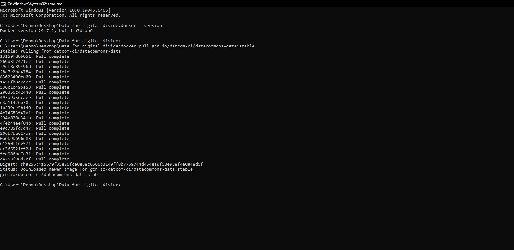

# Handover note: Kenya inflation (CBK) Data Commons import

## Status

Done and verified on 2026-10-15: 282 observations (2 variables × 141 months, Jan 2015 to Sep 2026) for
`country/KEN` loaded with `gcr.io/datcom-ci/datacommons-data:stable` ("Runner finished successfully").
`src/readback.py` matches the database with both the CSV and the source file, 282/282, with no differences
(`docs/readback_report.md`).

## How to re-run

```bash
python src/pipeline.py && python src/load.py && python src/readback.py
```

(PowerShell 5.1: `python src/pipeline.py; if ($?) { python src/load.py }; if ($?) { python src/readback.py }`.)
Each step is safe to repeat. The pipeline rebuilds its outputs from the source, sorted and de-duplicated, so two runs
give byte-identical files. The load deletes `output/datacommons/` first, so the database is always rebuilt from
scratch. Each step exits non-zero on failure, so the chain stops at the first problem.

**New month from CBK:** on [https://www.centralbank.go.ke/inflation-rates/](https://www.centralbank.go.ke/inflation-rates/), click **Excel** above the table and save
it as `source/Inflation Rates.xlsx`. Then run `python src/fetch_live.py`. It downloads the live page to
`source/cbk_inflation_live_<date>.html`, compares it with the export and rewrites `source/cbk_inflation_final.csv`
only if they agree. Update `source/download_date.txt`, then run the command above.

## Data loading

The load uses the official Data Commons data container. Before the first load, Docker must work and the image must be
pulled once (about 0.9 GB):

```bash
docker --version
docker pull gcr.io/datcom-ci/datacommons-data:stable
```

Docker 29.7.2 confirmed, and the loader image pulled (`Status: Downloaded newer image for gcr.io/datcom-ci/datacommons-data:stable`, digest `sha256:415679f3...`). See the screenshot under
"Problems hit and how they were resolved" below.

Then `python src/load.py` runs the container on `output/`. A good load ends with `Runner finished successfully` and
writes `output/datacommons/datacommons.db` (see the second screenshot below for the full expected output). This run wrote 282 observations and 21 MCF triples. The full log is in
`output/load.log`, with the API key masked.

## How to add another year

Change one line in `src/pipeline.py`:

```python
START_DATE = "2015-01"  # first month in scope (YYYY-MM)
```

to `"2010-01"` (the source goes back to 2005-01). The filter that uses it is
`df = df[df["date"] >= start]` in `to_long()`. Or, without editing: `python src/pipeline.py --start 2010-01`, then
`python src/load.py`, then `python src/readback.py --start 2010-01`. Tested: 2010-01 gives 402 rows (201 months × 2).

## How to add another variable

1. `src/pipeline.py`: add an entry to `VARIABLES`, keyed by the **exact column header** in the source, with `dcid`,
   `name`, `description` and `extra` (any additional MCF properties). The CSV rows and the MCF node are both
   generated from this entry.
2. `src/readback.py`: add the same `"Header": "dcid"` pair to its `VARIABLES` (kept separate on purpose, so the check
   does not reuse pipeline code).
3. Check every DCID you reference exists (e.g. on datacommons.org, or the API `/v2/node`), then re-run.

## Problems hit and how they were resolved

| Problem                                                                                                                                                                                                                         | Resolution                                                                                                                                                                                                                                                                                   |
| ------------------------------------------------------------------------------------------------------------------------------------------------------------------------------------------------------------------------------- | -------------------------------------------------------------------------------------------------------------------------------------------------------------------------------------------------------------------------------------------------------------------------------------------- |
| I first downloaded the excel sheet and the html file for this. The saved HTML contains only 2 data rows ("Showing 261 to 262 of 262 entries"), because the browser saved the visible page of a paginated table: not enough data | Fetched the live URL (`src/fetch_live.py`). The server's HTML has all 262 rows. Compared them row by row with the Excel export: 261 months, 0 differences. Saved the result as the final dataset `source/cbk_inflation_final.csv`, which everything after uses (`docs/source_comparison.md`) |
| `pandas.read_html` found no table in the fetched page                                                                                                                                                                           | The server sends the table with `style="display: none"` (JavaScript shows it), and `read_html` skips hidden elements by default. Fixed with `displayed_only=False`                                                                                                                           |
| `pandas.read_html` turned the year into `2005.0`, so the comparison found no matching rows                                                                                                                                      | Read the cells as text (`converters=str`)                                                                                                                                                                                                                                                    |
| April 2019 appears twice (identical values 4.91 / 6.58)                                                                                                                                                                         | Exact duplicate dropped and logged. A same-month row with _different_ values would stop the pipeline                                                                                                                                                                                         |
| The table header row appears twice in the HTML (`<thead>` has a header row and a filter row)                                                                                                                                    | Header rows are skipped. Multi-level headers are flattened to the first level                                                                                                                                                                                                                |
| Columns are Annual Average **then** 12-Month on the page                                                                                                                                                                        | Columns matched by header text, never position                                                                                                                                                                                                                                               |
| The guide's MCF uses `InflationRate` (does not exist in Data Commons) and `statType: Percent` (a unit, not a statType)                                                                                                          | Checked every DCID with the Data Commons API, then used `measuredProperty: inflation`, `statType: measuredValue`, `populationType: EconomicActivity`, `activitySource: ConsumerPriceIndex`, as the base graph's CPI variables do                                                             |
| The guide's check value "Jan 2015 = 3.28 / 4.21" is not right: those are the **Jan 2025** values                                                                                                                                | The source says Jan 2015 = 5.53 (12-month) / 6.74 (annual average). The readback report spot-checks both months                                                                                                                                                                              |
| I first ensured I check the docker version that is docker --version and then runned the command to pull the data container. as `docker pull gcr.io/datcom-ci/datacommons-data:stable`                                           | docker was not installed and therefore I installed it and added the path to the global path for my laptop so that I can use it from my terminal. I also runned the command to obtain the 1gb data pull from the command as shown.                                                            |
| Host paths with spaces / drive letters in `INPUT_DIR` vs the `-v` mount                                                                                                                                                         | Mount `output/` at `/data` and pass `INPUT_DIR`/`OUTPUT_DIR=/data` with `-e`, so they always match                                                                                                                                                                                           |
| The container prints the API key into its log                                                                                                                                                                                   | `src/load.py` masks every key/secret value from `env.list` before writing `output/load.log`                                                                                                                                                                                                  |
| `ERROR utils.py:94 No columns to parse from file` in the load log                                                                                                                                                               | Harmless. It comes from the natural-language index step after the load ("Runner finished successfully" is already logged)                                                                                                                                                                    |

**SCREENSHOT SHOWING THE DATA LOADING**



**Expected output, and my output, of the one command (load + readback):** the loader writes 282 observations and
21 MCF triples and ends with `Runner finished successfully` (import status `SUCCESS`, `numVars: 2, numObs: 282`).
The readback then reports 282 CSV rows, 282 database rows, 282 matching, 282 expected from the source:
`PASS`. The API key shows as `<redacted>`. The `ERROR ... No columns to parse from file` line is the harmless
search-index step after the load.


## Tools used, including AI, and how their output was checked

- **Tools:** Python 3.12 (pandas, lxml, openpyxl), Docker Desktop 29.7 with `gcr.io/datcom-ci/datacommons-data:stable`,
  SQLite (the container's output), the Data Commons REST API (`/v2/node`) to confirm DCIDs, git.
- **My Role:** I first got the API key, created the env file for those keys, Then went to the cbk inflation page, downloaded the csv, placed it inside the source folder, Then ensured docker is installed and running, I then now installed claude code for the automation and verification parts. I gave the claude code the url to use for the source data ([www.centralbank.go.ke/inflation-rates](https://www.centralbank.go.ke/inflation-rates/)) and then also saved the html myself inside the source folder as well. I now gave the claude code prompt on what to do as shown below.
- **How I used AI:** Claude Code (Claude Opus 5.5) drafted the import spec, `fetch_live.py`, `pipeline.py`, `load.py`, `readback.py` and these docs,
  ran them, and checked the DCIDs against the live API As I confirmed every output against my expectations.
- **How the output was checked:**
  - Spot-checked values against the source by hand: Jan 2015, Apr 2019 (the duplicate), Jan 2025, Sep 2026.
  - Row counts against the arithmetic: 141 months × 2 = 282.
  - Ran the pipeline twice and compared checksums of all outputs (identical).
  - The source itself was checked twice: the live page against the Excel export, row by row (0 differences).
  - `readback.py` compares the database with the CSV **and** with the final source dataset, which it re-parses
    itself with the csv module, so a pipeline bug cannot hide behind a matching CSV.
  - The readback was tested against a deliberately corrupted copy of the database (changed value, deleted row,
    blank unit). It reported all of them and exited 1, then passed again on the real database.
